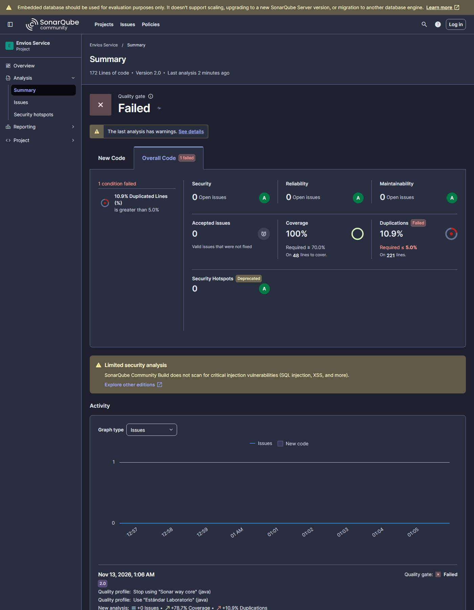
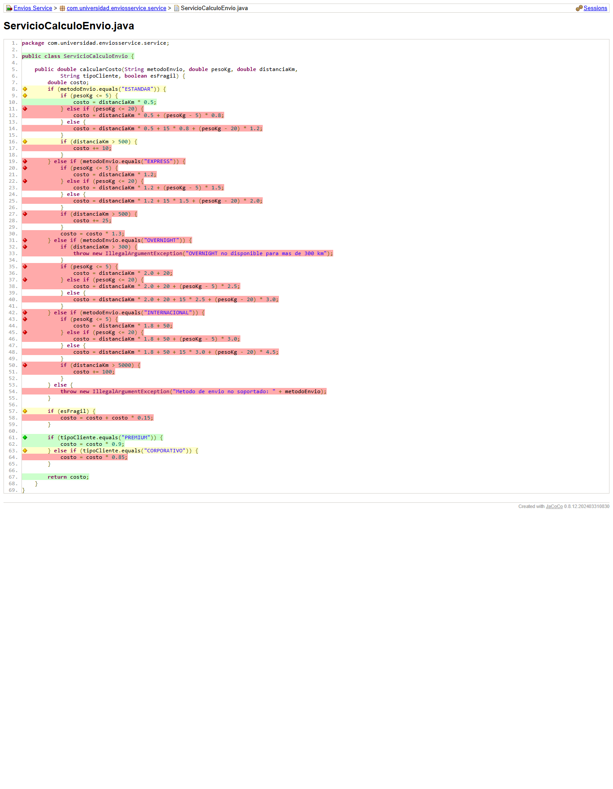
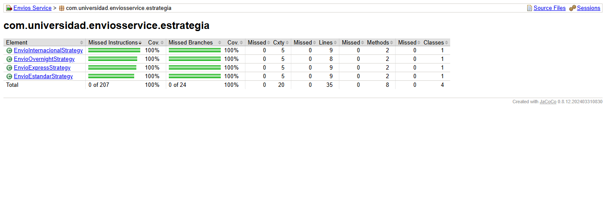
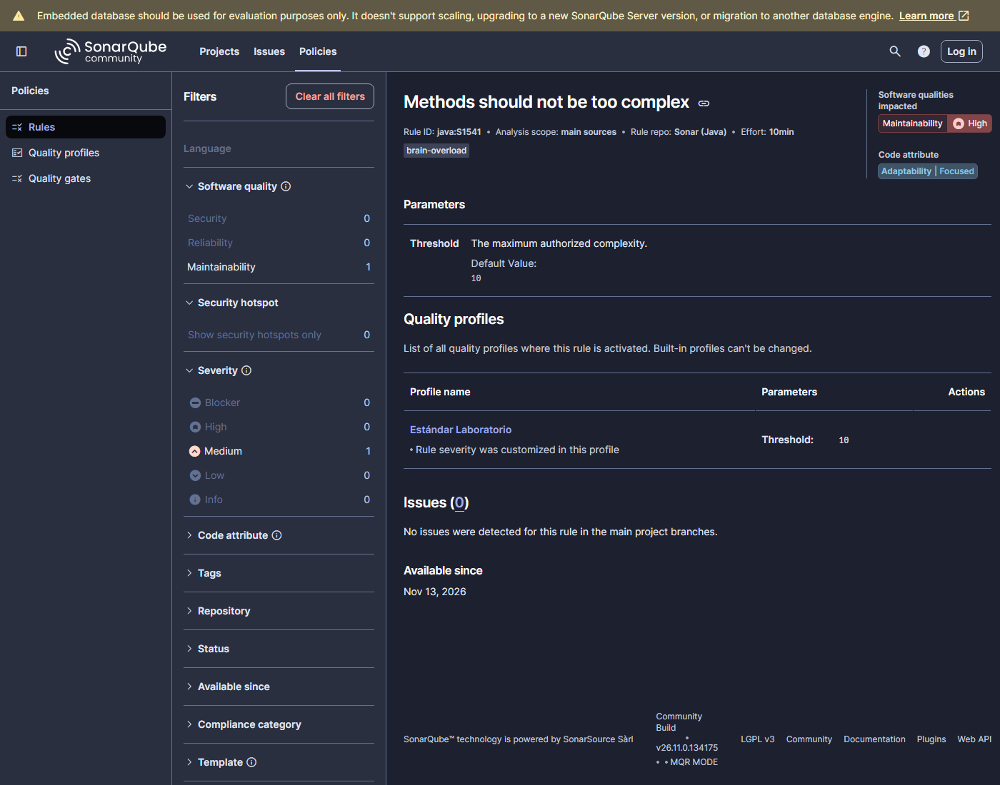
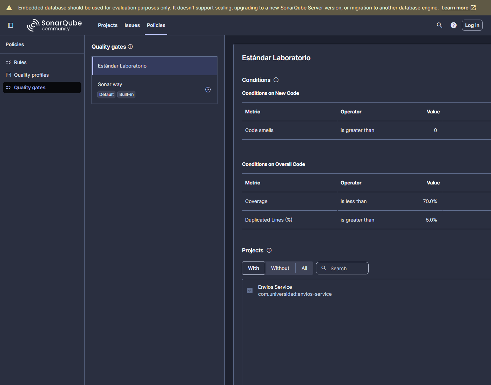
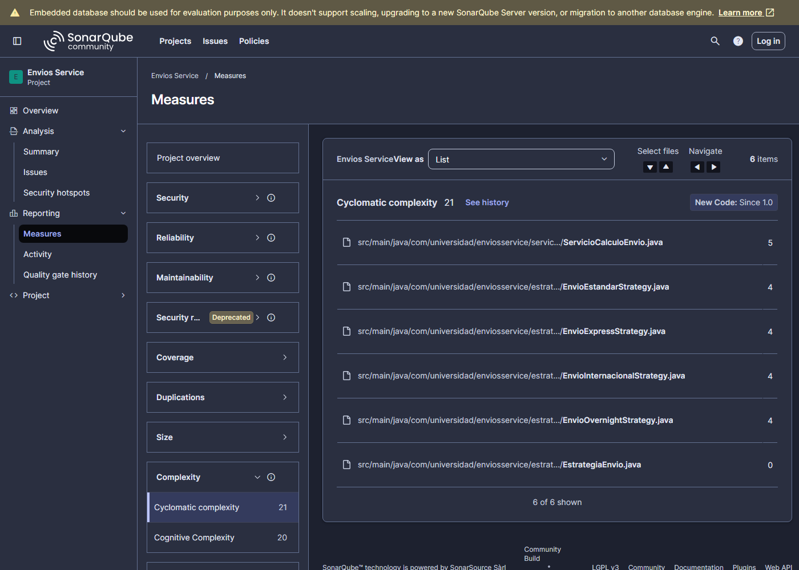
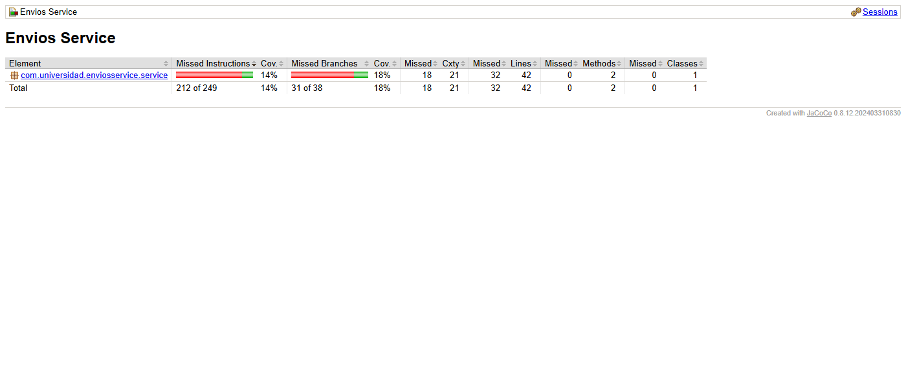
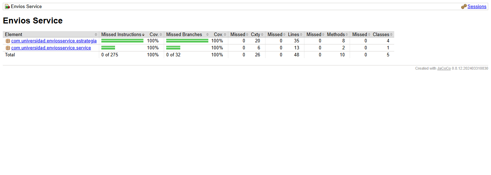
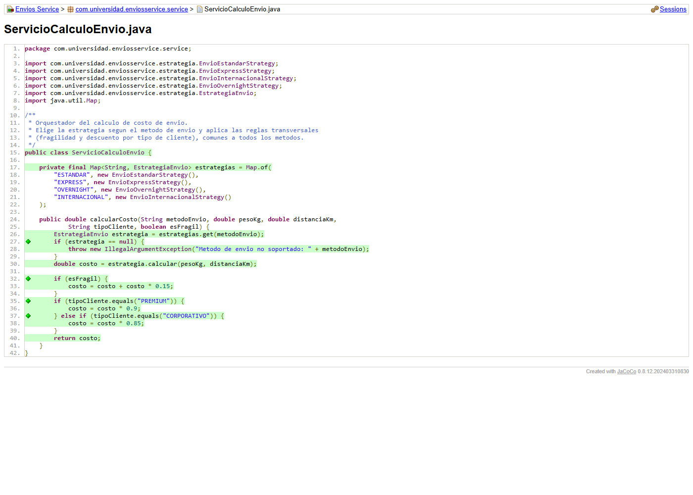

# Envios Service — Diagnóstico y Mejora Guiada por Métricas

Laboratorio de la Unidad 10 (Patrones de Diseño de Software, UDES): se diagnostica con métricas reales
(SonarQube + JaCoCo) un servicio que calcula el costo de un envío, se refactoriza con un patrón de diseño
elegido a partir de la naturaleza de sus condicionales y se comprueba con un segundo análisis que la mejora
es medible.

- **Autor:** Humberto Javier Mogollón Hernández (UDES, grupo 13671-A)
- **Stack:** Java 21, Maven, JUnit 5, JaCoCo, SonarQube Community Build (Docker)
- **Paquetes:** `service` (orquestador) y `estrategia` (patrón Strategy)

## Entorno de análisis

SonarQube Community Build 100 % local, en Docker (`sonarqube:community`, puerto 9000), versión del servidor
26.11.0.134175, con el proyecto `Envios Service` (key `com.universidad:envios-service`).
Las capturas y todas las cifras de este documento salen de dos ejecuciones reales de `mvn clean verify sonar:sonar`
contra ese servidor (fecha de los análisis: 13 de noviembre de 2026).

## Estado inicial del análisis (Parte 1)

| Métrica | Valor real observado |
|---------|----------------------|
| Complejidad ciclomática de `calcularCosto()` | 20 |
| Complejidad cognitiva de `calcularCosto()` | 32 |
| Cobertura de líneas de `ServicioCalculoEnvio` | 23,8 % (10 de 42) |
| Cobertura de ramas de `ServicioCalculoEnvio` | 18,4 % (7 de 38 ramas) |
| Code Smells reportados | 0 |
| Pruebas | 2 (las de partida) |

## Interpretación

El problema está concentrado en un único método: `ServicioCalculoEnvio.calcularCosto()`. SonarQube le atribuye una complejidad ciclomática de 20 (como la clase tiene un solo método explícito, el valor del archivo es el del método) y una complejidad cognitiva de 32, y JaCoCo confirma el mismo valor en la columna *Cxty* (20). Son 19 decisiones encadenadas en un solo bloque: la selección del método de envío, tres tramos de peso y un recargo por distancia dentro de cada método, la restricción de 300 km de OVERNIGHT, la fragilidad y los dos tipos de cliente con descuento.

El reporte JaCoCo muestra 31 de 38 ramas sin cubrir (7 de 38, 18 %) y 32 de 42 líneas sin ejecutar. Las condiciones `EXPRESS`, `OVERNIGHT` e `INTERNACIONAL` nunca se evalúan, porque las dos pruebas de partida usan `ESTANDAR` y la cadena `if/else if` se corta en la primera rama; por la misma razón tampoco se ejecutan sus tramos de peso, el recargo por distancia de EXPRESS e INTERNACIONAL, la excepción de OVERNIGHT por más de 300 km ni la excepción de método no soportado. Dentro de ESTANDAR solo se recorre el tramo `pesoKg <= 5` y nunca el recargo `distanciaKm > 500`; `esFragil` solo se evalúa como falso y la rama `CORPORATIVO` nunca se cumple. Complejidad alta y cobertura baja apuntan al mismo método porque son dos caras de un mismo hecho: 20 caminos independientes exigen al menos 20 casos de prueba para recorrerlos, y la suite tiene 2, de modo que la mayor parte de la lógica de negocio queda sin verificar justo donde el riesgo de error es mayor.

## Decisiones de diseño

### 1. Entorno de análisis: SonarQube local con Docker

Criterios tomados de la tabla de la guía:

- **Independencia de conectividad y de límites de un plan gratuito.** El servidor corre en la misma máquina,
  de modo que el análisis, las capturas y la reconfiguración de la Parte 2 no dependen de internet ni de las
  restricciones de un plan.
- **Control total de la configuración.** La Parte 2 exige duplicar un Quality Profile, activar una regla con
  umbral propio y crear un Quality Gate; con una instancia propia el usuario `admin` puede hacerlo todo sin
  limitaciones de organización.

El costo asumido es que consume recursos de la máquina (SonarQube arranca Elasticsearch y una JVM) y que el
contenedor debe permanecer encendido durante todo el laboratorio. SonarCloud habría dejado el dashboard accesible
desde cualquier equipo, pero un proyecto público es visible para cualquiera y exige cuenta y conexión.

### 2. Exclusiones del análisis: ninguna

No se usa `sonar.exclusions`. El proyecto no tiene clase `Main` ni código de arranque o de configuración: todas
las clases (`ServicioCalculoEnvio` y, tras la Parte 2, las cuatro estrategias) son lógica de negocio, y excluir
cualquiera ocultaría justamente el código cuya calidad se quiere medir. Si más adelante apareciera una clase de
arranque sin lógica propia, excluirla evitaría que su ausencia de pruebas distorsione el porcentaje global.

### 3. Métrica usada como señal principal: complejidad ciclomática

Se tomó la complejidad ciclomática como señal principal porque equivale al número de caminos independientes del método, es decir, al mínimo de pruebas necesarias para recorrerlo, y por eso se relaciona directamente con la cobertura de ramas. En `calcularCosto()` vale 20, el doble del techo "moderado" de 10, y explica de forma cuantitativa el 18 % de ramas cubiertas (7 de 38): dos pruebas no pueden recorrer veinte caminos. La complejidad cognitiva medida (32) confirma que el método es difícil de leer, pero penaliza el anidamiento y no se traduce en un número de pruebas; la cobertura, por sí sola, indica cuánto falta probar, pero no por qué cuesta probarlo. La ciclomática une ambas lecturas y señala qué intervenir: dividir el método por la decisión que más caminos genera, el método de envío.

### 4. Patrón elegido: Strategy

Se contrastó la naturaleza real de los condicionales de `calcularCosto()` con la tabla de patrones de la guía:

| Pregunta sobre el método | Respuesta | Consecuencia |
|--------------------------|-----------|--------------|
| ¿Guarda estado entre llamadas que condicione el comportamiento futuro? | No. La clase no tiene campos mutables; cada llamada es una función pura de sus cinco argumentos. | **Descarta State**: no hay estados ni transiciones válidas entre ellos. |
| ¿Hay una secuencia de responsables donde el orden importa y más de uno podría aplicar? | No. Los cuatro métodos de envío son mutuamente excluyentes (un valor de `metodoEnvio` activa exactamente una rama) y se evalúan una sola vez. | **Descarta Chain of Responsibility**: no hay encadenamiento ni "pasa al siguiente si no puedo". |
| ¿Cada rama calcula el mismo tipo de resultado con una fórmula propia, elegida una sola vez por un valor discreto? | Sí. Cada rama de `metodoEnvio` devuelve un costo con su propia tarifa y sus propios recargos, sin relación de orden con las demás. | **Strategy**: es exactamente la señal de reconocimiento del patrón. |

Qué se movió y qué se quedó, y por qué:

- **A las estrategias** (`EnvioEstandarStrategy`, `EnvioExpressStrategy`, `EnvioOvernightStrategy`,
  `EnvioInternacionalStrategy`): la tarifa por tramos de peso y los recargos que dependen del método (distancia
  mayor a 500 km en ESTANDAR y EXPRESS, multiplicador 1,3 de EXPRESS, restricción de 300 km de OVERNIGHT, recargo de
  5 000 km de INTERNACIONAL). Es lo que cambia cuando cambia "qué fórmula usar".
- **Al orquestador** (`ServicioCalculoEnvio`): la fragilidad (+15 %) y el descuento por tipo de cliente. Son
  reglas transversales: se aplican igual a todos los métodos de envío. Meterlas en cada estrategia las
  duplicaría cuatro veces y obligaría a tocar cuatro clases cada vez que cambie el descuento PREMIUM.

Por eso la complejidad de `calcularCosto()` no baja a 1: su CC esperada es 5 (1 base + estrategia nula +
fragilidad + los dos tramos de `tipoCliente`), dentro del rango "Moderada" de la Tabla 3.2 de la guía.
Resultado medido: 20 → 5.

### 5. Criterio de las pruebas agregadas

La cobertura subió cubriendo ramas concretas que el reporte JaCoCo de la Parte 1 marcaba en rojo, y verificando
valores calculados a mano, no invocando métodos. Con las dos pruebas de partida solo se ejercitaba el camino
ESTANDAR, tramo ≤ 5 kg, distancia ≤ 500 km, sin fragilidad, con cliente REGULAR o PREMIUM. Correspondencia entre
cada rama descubierta y la prueba que la cubre:

| Rama sin cubrir en la Parte 1 | Prueba que la cubre |
|-------------------------------|---------------------|
| Las condiciones `EXPRESS`, `OVERNIGHT` e `INTERNACIONAL` (nunca se evaluaban: la cadena se cortaba en ESTANDAR) | `ServicioCalculoEnvioTest.despachaCadaMetodoDeEnvioASuEstrategia` (cuatro métodos) |
| Rama `else` de método no soportado | `ServicioCalculoEnvioTest.rechazaMetodoDeEnvioNoSoportado` (verifica también el mensaje) |
| ESTANDAR: tramos `pesoKg <= 20` y `pesoKg > 20` | `EnvioEstandarStrategyTest.calculaCostoPorTramoDePeso` (8, 20 y 25 kg) |
| ESTANDAR: recargo `distanciaKm > 500` | `EnvioEstandarStrategyTest.aplicaRecargoSoloPorEncimaDe500Km` (500, 501 y 600 km: incluye el valor límite) |
| EXPRESS: los tres tramos de peso, el recargo de distancia y el multiplicador 1,3 | `EnvioExpressStrategyTest` (ambos métodos) |
| OVERNIGHT: los tres tramos de peso | `EnvioOvernightStrategyTest.calculaCostoPorTramoDePeso` |
| OVERNIGHT: `distanciaKm > 300` (excepción) y el límite exacto de 300 km | `rechazaDistanciasMayoresA300Km` y `aceptaExactamente300Km` |
| INTERNACIONAL: tres tramos de peso y recargo `distanciaKm > 5000` | `EnvioInternacionalStrategyTest` (5 000, 5 001 y 6 000 km) |
| `esFragil == true` | `ServicioCalculoEnvioTest.aplicaRecargoDeFragilidadDel15PorCiento` |
| `tipoCliente` CORPORATIVO | `ServicioCalculoEnvioTest.aplicaDescuentoClienteCorporativo` |
| Orden de las reglas transversales (fragilidad antes del descuento) | `combinaFragilidadYDescuentoPremiumEnEseOrden` y `combinaEstrategiaFragilidadYDescuentoCorporativo` |

Criterios para que una prueba cuente: cubre una rama distinta o un valor límite, y su resultado esperado se
calculó de forma independiente (a mano o con la fórmula original), por ejemplo `OVERNIGHT, 25 kg, 100 km =
200 + 20 + 15 × 2,5 + 5 × 3 = 272,5`. Se agregan los valores límite (5, 20, 300, 500 y 5 000) porque es donde
un operador `<` en vez de `<=` produciría un error que una prueba "del medio del rango" no detecta. Además, el
refactor se contrastó contra la clase original con una malla de 14 112 combinaciones de entrada: todas dieron
exactamente el mismo costo o la misma excepción con el mismo mensaje.

### 6. Realismo del Quality Gate

**Quality Profile "Estándar Laboratorio"** (copia de "Sonar way core", el perfil Java integrado y predeterminado de esta versión, que no es editable): activa la regla S1541
(*Methods should not be too complex*, nombre que tiene en SonarQube 26.11; parámetro `Threshold`, valor por defecto 10) con `Threshold = 10`.
**Quality Gate "Estándar Laboratorio"**, asignado al proyecto, con tres condiciones:

| Condición | Umbral | Alcance |
|-----------|--------|---------|
| Coverage | menor a 70 % bloquea | código total |
| New Code Smells | mayor a 0 bloquea | código nuevo (incluye métodos que superen CC = 10 vía S1541) |
| Duplicated Lines (%) | mayor a 5 % bloquea | código total |

- **Por qué CC = 10 por método y no 5 o 20.** Según la Tabla 3.2 de la guía, 10 es el techo del rango "Moderada"
  (5–10) y 20 es el techo del rango "Alta": con 20 el método original (CC = 20) habría estado en el
  límite y nada habría obligado a refactorizarlo; con 5 se exigiría reescribir métodos todavía razonables de
  mantener, como cada estrategia (CC = 4) más cualquier cambio futuro. Con 10 el método original se señala
  claramente y los resultantes pasan con margen. 10 es además el valor por defecto del parámetro de la regla S1541.
- **Por qué 70 % de cobertura y no 100 %.** Exigir 100 % empuja a escribir pruebas triviales solo para llenar el
  número (los incentivos perversos de la Sección 2.3 de la guía); 70 % deja margen para código de
  infraestructura sin forzar pruebas vacías. Tras este refactor la cobertura medida es 100,0 %,
  muy por encima del umbral, que es lo esperado cuando las pruebas verifican ramas reales: el umbral es un piso, no
  un objetivo.
- **Qué mide y qué no.** El gate de cobertura mide ejecución, no verificación: una suite con aserciones vacías
  también lo pasaría, por eso el criterio de la Decisión 5 (valores esperados calculados e independientes) es
  complementario y no está en el gate.
- **Resultado del gate en el segundo análisis: Failed.** Detalle de cada condición según `api/qualitygates/project_status`:

  - **Coverage (código total): cumple.** Valor real 100,0 % frente al mínimo de 70 % (48 de 48 líneas y 32 de 32 ramas).
  - **New Code Smells (código nuevo desde la versión 1.0): cumple.** Valor real 0; ningún método supera CC = 10 (el máximo es 5), así que S1541 no levanta issues.
  - **Duplicated Lines (%) (código total): falla.** Valor real 10,9 % frente al máximo de 5 %. Son 24 líneas duplicadas de 221: un bloque de 12 líneas (líneas 5–16) que el detector de duplicados (CPD) encuentra idéntico en `EnvioEstandarStrategy` y `EnvioExpressStrategy`. CPD compara la estructura e ignora los literales, y ambas estrategias tienen exactamente la misma forma: tres tramos de peso más un recargo por encima de 500 km, con tarifas distintas. El denominador incluye las 77 líneas de `pom.xml`; sin él el porcentaje sería aún mayor. No hay Code Smells que corregir y la duplicación no se puede eliminar sin cambiar el diseño (habría que introducir una clase base de "tarifa por tramos" o una tabla de tarifas, algo que el laboratorio no pide), por eso no se siguió refactorizando y el umbral no se bajó. El gate cumple su función: señala una deuda real que la métrica de complejidad no muestra.

## Comparación antes / después

| Métrica | Antes (Parte 1) | Después (Parte 2) |
|---------|------------------|--------------------|
| Complejidad ciclomática de `calcularCosto()` | 20 | 5 (75 % menos) |
| Complejidad ciclomática máxima de un método (clases nuevas) | — | 4 (`calcular()` de cada una de las cuatro estrategias) |
| Complejidad cognitiva de `calcularCosto()` | 32 | 4 |
| Cobertura de líneas de la lógica de envío | 23,8 % (10 de 42) | 100 % (48 de 48) |
| Cobertura de ramas de la lógica de envío | 18,4 % | 100 % (32 de 32) (+81,6 puntos) |
| Code Smells (perfil Java usado) | 0 ("Sonar way core", predeterminado) | 0 ("Estándar Laboratorio" = Sonar way core + S1541) |
| Duplicación | 0,0 % | 10,9 % (24 de 221 líneas) |
| Pruebas | 2 | 43 |
| Quality Gate "Estándar Laboratorio" | — | Failed |

**Importante sobre los perfiles.** El "antes" se midió con el perfil por defecto de esta versión ("Sonar way core") y el
"después" con "Estándar Laboratorio" (la misma base más S1541 con umbral 10). Los dos análisis dan 0 Code Smells, pero
esos ceros no son comparables entre sí y no deben leerse como una mejora del código: con el perfil por defecto el
método original no generaba ningún issue porque ese perfil no incluye reglas de complejidad. Con S1541 activa, el
método original (CC = 20) habría superado el umbral de 10, aunque eso no se midió porque el perfil se asignó después
del refactor. La mejora se mide con la complejidad, la cobertura y las pruebas,
que no dependen del perfil.

Metas de la guía: reducción de CC de al menos 50 % y aumento de cobertura de ramas de al menos 15 puntos. Resultado
medido: 75 % de reducción y +81,6 puntos de cobertura de ramas; ambas metas se cumplen.

## Capturas

| Parte 1 (antes) | Parte 2 (después) |
|-----------------|-------------------|
|  |  |
|  |  |

Configuración del servidor para la Parte 2: la regla S1541 activa en el perfil "Estándar Laboratorio" con `Threshold = 10`, y el Quality Gate "Estándar Laboratorio" con sus tres condiciones, asignado al proyecto.




El resumen de SonarQube no muestra la complejidad, por eso también se incluye la página *Measures → Complexity* antes y después, y el resumen de JaCoCo de todo el proyecto y de `ServicioCalculoEnvio` tras el refactor:

| Antes | Después |
|-------|---------|
|  |  |
|  |  |
| |  |

En el reporte JaCoCo de cada estrategia la columna *Cxty* de la clase vale 5 porque suma el constructor implícito (1); la del método `calcular` es 4, la misma que reporta SonarQube.

## Ajustes deliberados sobre la guía

Durante el laboratorio se detectaron cuatro puntos iniciales en los que seguir la guía al pie de la letra habría producido un
resultado incorrecto; esto fue lo que se hizo y por qué:

1. **Valor esperado de `EnvioOvernightStrategyTest`.** La guía da `250.0` para 25 kg y 100 km, pero la fórmula de
   OVERNIGHT da `100 × 2 + 20 + 15 × 2,5 + (25 − 20) × 3 = 272,5`. Se usa 272,5, confirmado contra la clase original.
2. **`sonar-project.properties` no es leído por el scanner de Maven.** `mvn sonar:sonar` toma la configuración del
   `pom.xml` y de las propiedades `-D`; el archivo `.properties` es del scanner de línea de comandos. El archivo se
   conserva, comentado, y las mismas claves viven en `<properties>` del `pom.xml` para que el análisis las use.
3. **No existe el perfil "Sonar way" y el predeterminado no activa reglas de complejidad.** En SonarQube 26.11 el
   perfil Java por defecto es "Sonar way core", que no activa ni la regla de complejidad cognitiva S3776 ni la
   ciclomática S1541. Por eso el análisis inicial reporta 0 Code Smells (y 0 issues en total) aunque
   `calcularCosto()` tiene CC = 20 y complejidad cognitiva 32. S1541 se activa de forma explícita en el perfil
   "Estándar Laboratorio".
4. **Versión del proyecto.** El primer análisis se hizo con la versión `1.0` y el segundo con `2.0`, para que
   "código nuevo" del Quality Gate signifique "lo cambiado en el refactor" y no todo el código.

Desviaciones adicionales encontradas con SonarQube 26.11.0.134175:

5. **Perfil base "Sonar way core".** En esta versión no existe un perfil Java llamado "Sonar way": hay "Sonar way core" (el predeterminado, 263 reglas), "Sonar way extended", "Sonar way comprehensive" y "Sonar agentic AI". "Estándar Laboratorio" se creó como copia de "Sonar way core" y se le agregó S1541 (264 reglas activas).
6. **Condiciones automáticas del Quality Gate.** Al crear un gate, esta versión le agrega cuatro condiciones "Clean as You Code" (`new_coverage < 80`, `new_duplicated_lines_density > 3`, `new_security_hotspots_reviewed < 100`, `new_violations > 0`). Se eliminaron **antes** del segundo análisis, sin conocer aún su resultado, para que el gate tuviera exactamente las tres condiciones del diseño. Ningún umbral de las tres condiciones se modificó.
7. **API.** `qualityprofiles/add_project` ya no acepta `key` y exige `language` + `qualityProfile` (nombre); el nombre "Estándar Laboratorio" se envió codificado en UTF-8 (`Est%C3%A1ndar`) porque el terminal de Windows lo mandaba en Latin-1 y el servidor respondía HTTP 500.
8. **Sin cambios al código del material.** El código de `etapa1/` y `etapa2/` se usó tal cual. La equivalencia del refactor se comprobó fuera del repositorio con una malla de 14 112 combinaciones (7 métodos, incluidos tres inválidos; 14 pesos; 18 distancias, con los límites 5, 20, 300, 500 y 5 000 y sus vecinos; 4 tipos de cliente; fragilidad sí/no): 0 diferencias en el costo (comparación exacta del `double`) ni en el tipo o mensaje de la excepción.
9. **Entorno.** Se compiló con JDK 22.0.2 (el `pom.xml` fija `release 21`) y Maven 3.9.16. SonarQube advierte que `sonar-maven-plugin 3.11.0.3922` está desactualizado; no se cambió para no alterar el `pom.xml` del material, y el análisis terminó sin errores.

## Cómo reproducirlo

```bash
docker run -d --name sonarqube -p 9000:9000 -e SONAR_ES_BOOTSTRAP_CHECKS_DISABLE=true sonarqube:community
# esperar "SonarQube is operational" y generar un token en My Account > Security
mvn clean verify                                   # pruebas + reporte JaCoCo (target/site/jacoco/index.html)
mvn clean verify sonar:sonar -Dsonar.token=TU_TOKEN
```

El token no se guarda en el repositorio.

## Herramientas utilizadas

- Java 21, Apache Maven, JUnit 5 (incluye pruebas parametrizadas)
- SonarQube Community Build (Docker), JaCoCo 0.8.12, sonar-maven-plugin 3.11.0.3922
- Git, GitHub

## Conclusiones

Las métricas se leen mejor por separado: la complejidad ciclomática (20) explicaba por qué la cobertura de ramas era tan baja (18,4 %), mientras que la ausencia de Code Smells en el primer análisis solo indicaba que el perfil por defecto no incluía reglas de complejidad, no que el código estuviera sano. El patrón se eligió por la naturaleza de los condicionales: ramas excluyentes, sin estado y elegidas una sola vez por un valor discreto apuntaban a Strategy, y el resultado fue una reducción medida de 20 a 5 (75 %) sin cambiar el comportamiento en 14 112 combinaciones de entrada. La cobertura del 100 % es significativa porque cada prueba verifica un valor calculado de forma independiente y los valores límite, no porque se haya perseguido el número. El Quality Gate funcionó como piso y no como objetivo: falló por la duplicación estructural entre dos estrategias, una deuda que ni la complejidad ni la cobertura muestran, y también dejó ver su límite, porque mide forma y ejecución, no si las pruebas verifican algo.
