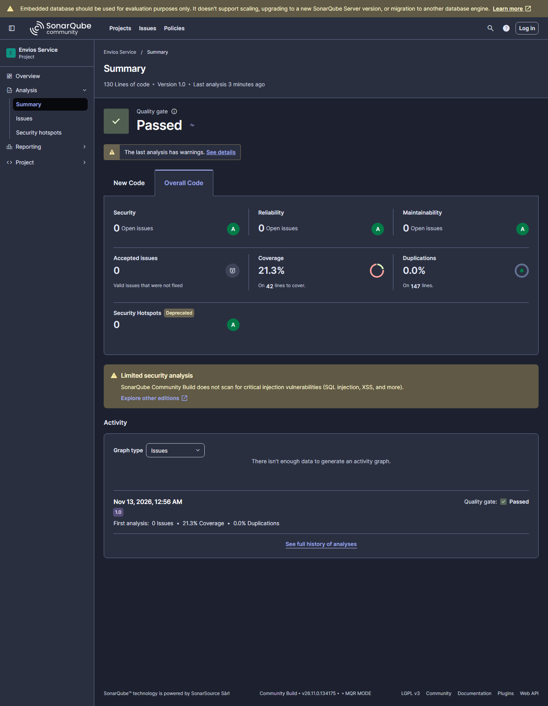
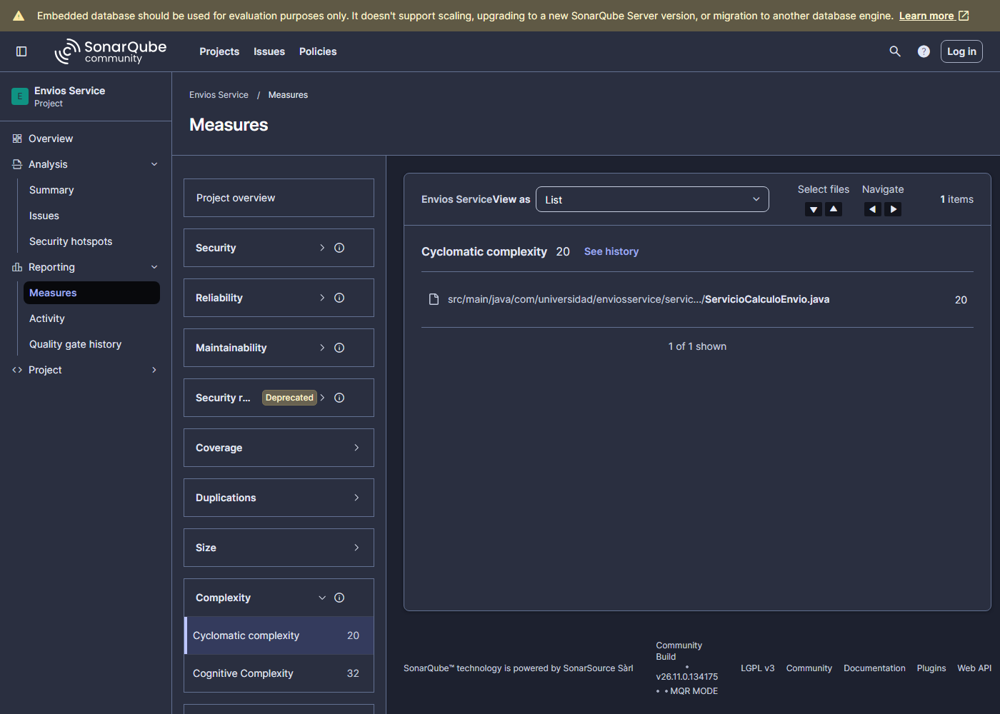

# Envios Service — Análisis de Métricas de Calidad

## Entorno de análisis

SonarQube Community Build local, en Docker (`sonarqube:community`, puerto 9000), versión del servidor
26.11.0.134175. Se eligió por dos criterios de la tabla de la guía: no depende de conectividad ni de límites
de un plan gratuito, y da control total de la configuración (en la Parte 2 hay que duplicar un perfil de calidad
y crear un Quality Gate). El costo asumido es el consumo de recursos de la máquina y mantener el contenedor
encendido durante el laboratorio.

## Estado inicial del análisis

| Métrica | Valor real observado |
|---------|----------------------|
| Complejidad ciclomática de `calcularCosto()` | 20 |
| Cobertura de líneas de `ServicioCalculoEnvio` | 23,8 % (10 de 42 líneas) |
| Cobertura de ramas de `ServicioCalculoEnvio` | 18,4 % (7 de 38 ramas) |
| Code Smells reportados | 0 (perfil Java por defecto de esta versión, "Sonar way core", que no incluye la regla de complejidad cognitiva S3776 ni la ciclomática S1541) |

## Interpretación

El problema está concentrado en un único método: `ServicioCalculoEnvio.calcularCosto()`. SonarQube le atribuye una complejidad ciclomática de 20 (como la clase tiene un solo método explícito, el valor del archivo es el del método) y una complejidad cognitiva de 32, y JaCoCo confirma el mismo valor en la columna *Cxty* (20). Son 19 decisiones encadenadas en un solo bloque: la selección del método de envío, tres tramos de peso y un recargo por distancia dentro de cada método, la restricción de 300 km de OVERNIGHT, la fragilidad y los dos tipos de cliente con descuento.

El reporte JaCoCo muestra 31 de 38 ramas sin cubrir (7 de 38, 18 %) y 32 de 42 líneas sin ejecutar. Las condiciones `EXPRESS`, `OVERNIGHT` e `INTERNACIONAL` nunca se evalúan, porque las dos pruebas de partida usan `ESTANDAR` y la cadena `if/else if` se corta en la primera rama; por la misma razón tampoco se ejecutan sus tramos de peso, el recargo por distancia de EXPRESS e INTERNACIONAL, la excepción de OVERNIGHT por más de 300 km ni la excepción de método no soportado. Dentro de ESTANDAR solo se recorre el tramo `pesoKg <= 5` y nunca el recargo `distanciaKm > 500`; `esFragil` solo se evalúa como falso y la rama `CORPORATIVO` nunca se cumple. Complejidad alta y cobertura baja apuntan al mismo método porque son dos caras de un mismo hecho: 20 caminos independientes exigen al menos 20 casos de prueba para recorrerlos, y la suite tiene 2, de modo que la mayor parte de la lógica de negocio queda sin verificar justo donde el riesgo de error es mayor.

### Decisión de diseño 2 — exclusiones

Ninguna. El proyecto no tiene clase `Main` ni código de arranque: toda clase es lógica de negocio y excluirla
ocultaría el código cuya calidad se quiere medir.

### Decisión de diseño 3 — señal principal

Se tomó la complejidad ciclomática como señal principal porque equivale al número de caminos independientes del método, es decir, al mínimo de pruebas necesarias para recorrerlo, y por eso se relaciona directamente con la cobertura de ramas. En `calcularCosto()` vale 20, el doble del techo "moderado" de 10, y explica de forma cuantitativa el 18 % de ramas cubiertas (7 de 38): dos pruebas no pueden recorrer veinte caminos. La complejidad cognitiva medida (32) confirma que el método es difícil de leer, pero penaliza el anidamiento y no se traduce en un número de pruebas; la cobertura, por sí sola, indica cuánto falta probar, pero no por qué cuesta probarlo. La ciclomática une ambas lecturas y señala qué intervenir: dividir el método por la decisión que más caminos genera, el método de envío.

## Capturas del análisis inicial

El resumen de SonarQube no muestra la complejidad, por eso se agrega la página *Measures → Complexity*
(ciclomática 20, cognitiva 32). Complejidad cognitiva medida: 32; duplicación: 0,0 %.
